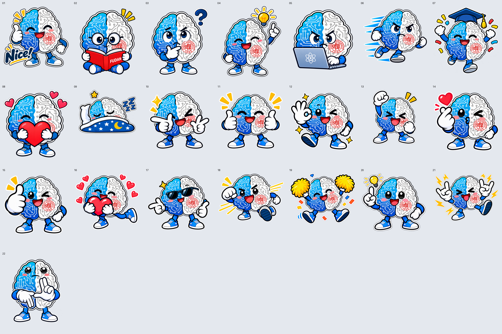

# 脑智角色表情创作 Skill

用同一份脑部、电路和校徽母版，创作新的表情、动作与透明贴纸。



## 下载与安装

在 GitHub 页面选择 **Code → Download ZIP**，解压后将文件夹重命名为 `ibi-emoji`。包内含完整素材，无需 Git LFS。

按当前官方文档，将整个文件夹放入个人技能目录 `~/.agents/skills/ibi-emoji`，确保 `SKILL.md` 直接位于该文件夹内。Windows 对应用户目录下的 `.agents\skills\ibi-emoji`。在 WSL 中运行 Codex 时，使用 WSL 的用户目录。Codex 会自动发现技能，如果没有出现，重启后再调用 `$ibi-emoji`。安装位置说明见 [OpenAI 官方技能文档](https://developers.openai.com/codex/skills#where-to-save-skills)。

也可以对安装了 skill-installer 的 Codex 说下面这句话。

```text
请使用 skill-installer，从 https://github.com/ExiaSit/ibi-emoji-skill 安装根目录下的 skill，命名为 ibi-emoji。
```

## 同事如何创作

首次使用时，可以把下面这段发给 Codex，让它检查运行环境并复现一个已有示例。

```text
使用 $ibi-emoji，按 README 检查 Python、Pillow、CairoSVG 和系统 Cairo，安装缺少的依赖。验证素材包，复现第 22 款表情并展示预览。检查当前会话是否提供图像生成或编辑工具，告诉我能否创作全新动作。
```

安装后上传动作参考图，或直接描述表情。

```text
使用 $ibi-emoji，做一款熬夜写论文的表情，困倦但还在坚持，透明背景，无文字。
```

```text
使用 $ibi-emoji，参考我上传图片的眼神和双手动作，用现有角色做一款新表情。
```

skill 会先查看角色素材，再用可用的内置图像编辑工具制作表情、手脚和道具层。合成脚本将这一层与固定身体母版组合。图像生成需要宿主提供相应能力，随包脚本可直接复现已有 22 款示例。

## 素材结构

| 路径 | 内容 |
| --- | --- |
| `SKILL.md` | 可安装的技能入口 |
| `assets/body/master.svg` | 脑部、电路线和校徽固定母版 |
| `assets/body/master.png` | 查看母版用的透明图 |
| `assets/body/geometry.json` | 固定坐标与母版 SHA-256 |
| `assets/foreground/01.png` 至 `22.png` | 可复用的表情、手脚、道具层 |
| `assets/examples/` | 22 款成品和相应场景 JSON |
| `assets/catalog.json` | 编号与动作名称索引 |
| `scripts/render.py` | 合成 PNG、分层 SVG、预览和制作记录 |
| `scripts/verify.py` | 验证素材及导出结果 |
| `references/` | 前景提示词、参数说明和印刷交接 |

校徽相对身体的位置和比例在母版里定义一次。表情和道具自然遮挡母版。每个场景只调整整个身体的布局和姿态。

## 本地运行

需要 Python 3.10 或更新版本，以及系统 Cairo 库。进入解压后的技能目录后创建独立环境并安装 Python 依赖。

```bash
python3 -m venv .venv
source .venv/bin/activate
python -m pip install -r requirements.txt
```

macOS 可通过 Homebrew 安装 Cairo。

```bash
brew install cairo libffi
export DYLD_FALLBACK_LIBRARY_PATH="$(brew --prefix)/lib${DYLD_FALLBACK_LIBRARY_PATH:+:$DYLD_FALLBACK_LIBRARY_PATH}"
```

Ubuntu / Debian 可安装系统库 `libcairo2`。依赖需要编译时，再安装 `python3-dev` 和 `libffi-dev`。Windows 可在 WSL 的 Ubuntu 环境运行上述流程。其他系统的 Cairo 安装说明见 [CairoSVG 官方文档](https://cairosvg.org/documentation/)。

验证素材并复现 22 号手势。

```bash
python scripts/verify.py --bundle
python scripts/render.py --example 22 --output outputs/gesture
python scripts/verify.py --output outputs/gesture
```

将新生成的透明前景保存为 `work/foreground.png`，再把下面内容保存为 `work/scene.json`。

```json
{
  "foreground": "foreground.png",
  "body_box_norm": [0.15, 0.04, 0.70, 0.77],
  "rotation": 0
}
```

```bash
python scripts/render.py --config work/scene.json --output outputs/new-emoji
python scripts/verify.py --output outputs/new-emoji
```

输出包括透明 PNG、自包含 SVG、浅色底预览和 JSON 制作记录。脚本会保护已有同名输出，明确需要覆盖时使用 `--force`。

## 验收

脚本验证嵌入的身体母版、前景、Alpha 和文件校验值。交付前仍需查看实际图片，确认手指方向、肢体连接、眼神和遮挡符合创作要求。可以调整身体整体姿态或前景布局，再重新合成。

当前包包含 21 款 V5 实例和第 22 款淡定手势，保留了二维身体整体变形的配置。较明显的宽高拉伸也会改变校徽形状，可在场景参数中调整整个身体框。

素材来源见 [来源记录](ASSET_SOURCES.md)。

2026-11-03 在 macOS、Pillow 13.0.0 和 CairoSVG 2.9.1 环境验证了全部 22 款实例。新脚本重建的 RGBA 像素与所附实例逐像素一致，并检查了已有输出保护。Windows 和 Linux 的安装方式尚未在本项目中实机验证。
